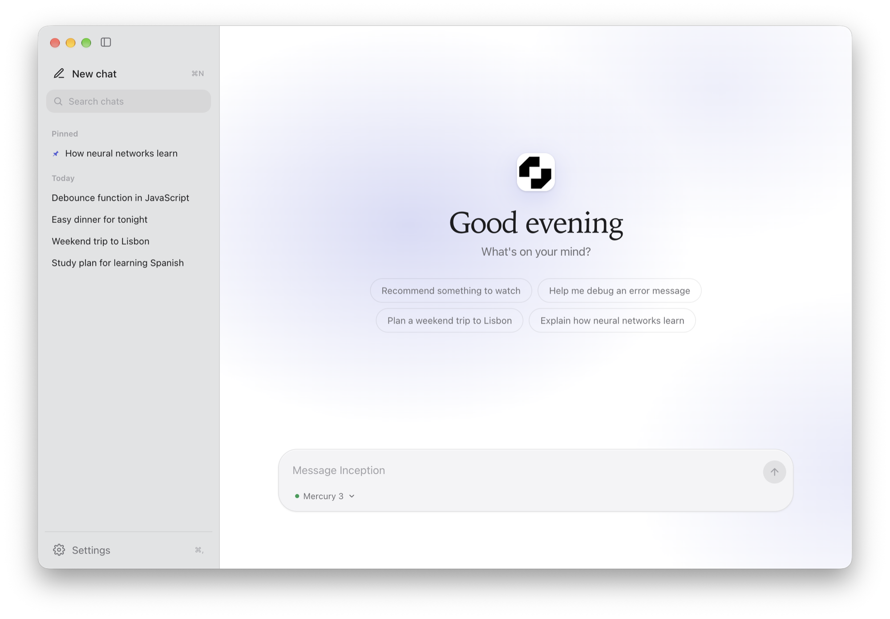
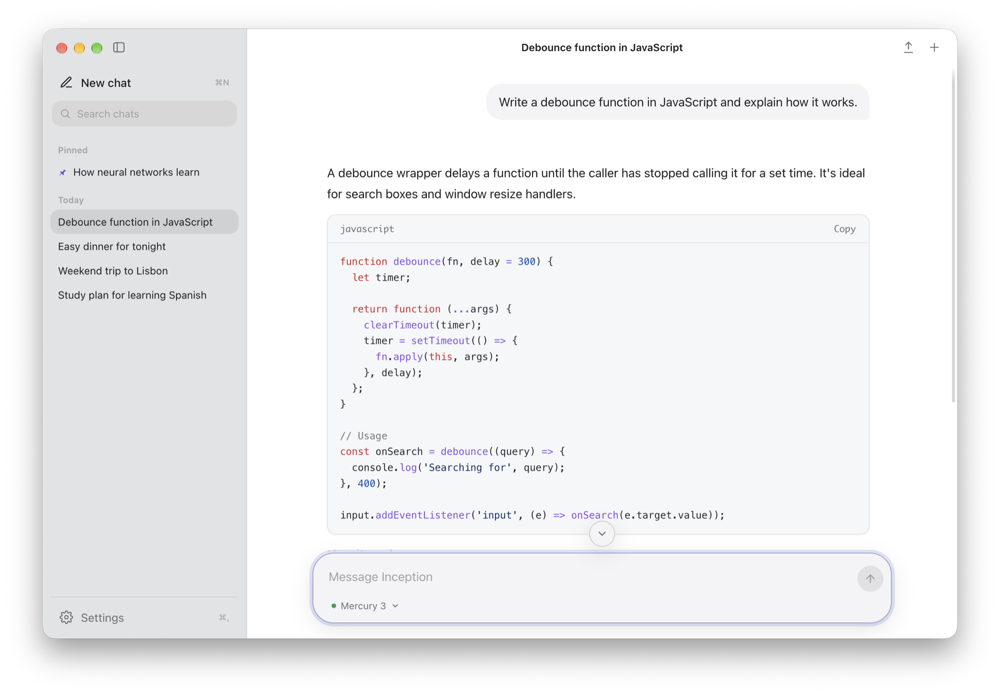
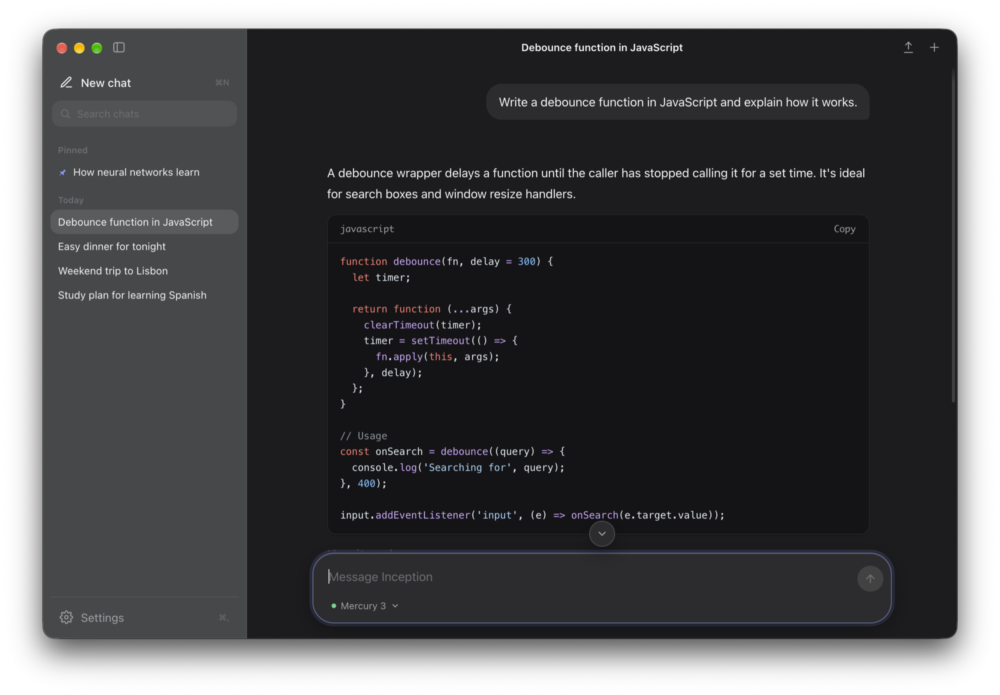

# Inception

A fast, friendly desktop chat app for [Inception Labs](https://inceptionlabs.ai) Mercury models, built with Electron.

<p align="center">
  
</p>

<p align="center">
  
  
</p>

## Features

**Chat**
- Chat with Mercury models via the Inception Labs API or OpenRouter
- Replies stream in as formatted markdown, with syntax-highlighted code, math (KaTeX) and Mermaid diagrams
- Long code blocks collapse by default, with one-click copy
- Optional faster answers for models that support reasoning
- Edit a message, try again, or stop a reply mid-stream

**Your conversations**
- Persistent history stored locally with SQLite, grouped by date
- Search and pin chats from the sidebar, and export any chat as Markdown

**Made for the Mac (and everywhere else)**
- Native frosted-glass sidebar and window controls on macOS
- Light, dark, or match-system themes, with five accent colors
- System tray support (macOS) to stay running in the background
- Auto-update from GitHub Releases
- Cross-platform: macOS, Windows, Linux

## Models

| Model | Inception Labs | OpenRouter |
|---|---|---|
| Mercury | ✓ (`mercury-edit`) | ✓ (`inception/mercury`) |
| Mercury 3 | ✓ (`mercury-3`) | ✓ (`inception/mercury-3`) |
| Mercury 2 | ✓ (`mercury-2`) | — |
| Mercury Coder | — | ✓ (`inception/mercury-coder`) |

## Getting Started

### Prerequisites

- [Node.js](https://nodejs.org) (v18+)
- An [Inception Labs API key](https://platform.inceptionlabs.ai/dashboard/api-keys)

### Installation

```bash
npm install
```

Native modules (better-sqlite3) are rebuilt automatically via the `postinstall` script.

### Running

```bash
# Production mode
npm start

# Development mode (opens DevTools)
npm run dev
```

### Configuration

On first launch, paste your API key into the welcome screen. You can change it later in Settings (`Cmd/Ctrl+,`). Available providers:

| Provider | Setting |
|---|---|
| Inception Labs | API key from [platform.inceptionlabs.ai](https://platform.inceptionlabs.ai/dashboard/api-keys) |
| OpenRouter | API key from [openrouter.ai](https://openrouter.ai) |

Settings (appearance, accent color, model, reply length, custom instructions) are saved to the Electron userData directory. API keys are stored in `~/.inception/config.json`.

## Building

```bash
# All platforms
npm run build

# macOS only
npm run build-mac

# Windows only
npm run build-win

# Linux only
npm run build-linux
```

Build output goes to `dist/`. Linux builds produce AppImage, .deb, and .rpm packages.

## Keyboard Shortcuts

| Shortcut | Action |
|---|---|
| `Cmd/Ctrl+N` | New chat |
| `Cmd/Ctrl+K` | Search chats |
| `Cmd/Ctrl+,` | Open Settings |
| `Cmd/Ctrl+B` | Show or hide the sidebar |
| `Cmd/Ctrl+/` | Focus the message box |
| `Esc` | Stop generating |
| `Cmd+Q` / `Ctrl+Q` | Quit |

## License

MIT — © 2025 Tim Tully
